# Umsetzung RefCard05 von Jay und Livio
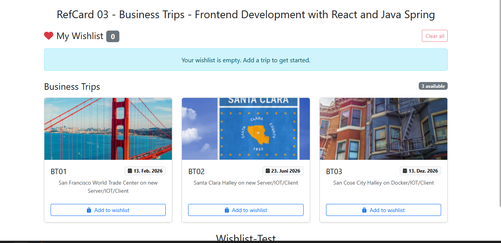

## 1. Repos klonen und vorbereiten

Zuerst haben wir die vorhandenen Repositories geforkt und lokal geklont. anschließend haben wir beide Projekte in IntelliJ geöffnet. Für das Frontend und das Backend haben wir getrennte Repositories erstellt, damit die Pipelines unabhängig voneinander laufen können.

## 2. Frontend-Repository anpassen

Die Pipeline in `.github/workflows/deploy.yml` haben wir für AWS ECR und ECS konfiguriert und Tests sowie den Build in GitHub Actions integriert. Ausserdem haben wir in AWS das ECR-Repository `frontend` erstellt und die Datei `task-definition.json` angepasst. Dabei haben wir den Containernamen auf den ECS-Container abgestimmt und sowohl die Familienbezeichnung als auch die Image-Referenz an die AWS-Umgebung abgestimmt.

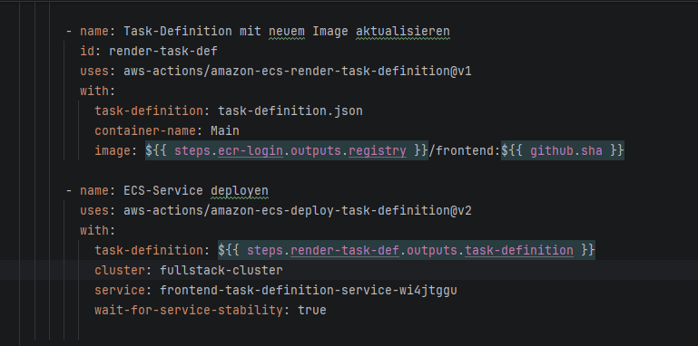

## 3. Backend-Repository anpassen

Im Backend haben wir die Pipeline in `.github/workflows/deploy.yml` für AWS ECR und ECS eingerichtet. Maven-Tests und der Build wurden in GitHub Actions integriert. Zudem haben wir das ECR-Repository `backend` angelegt und die Datei `task-definition.json` an die AWS-Konfiguration angepasst. Der Containername wurde mit dem ECS-Container abgeglichen, ebenso wurden Familienbezeichnung und Image-Referenz passend zur AWS-Umgebung gesetzt.

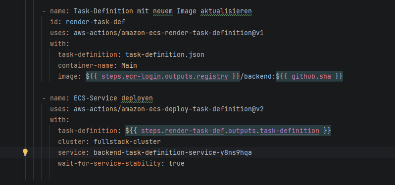

## 4. GitHub Secrets setzen

In beiden Repositories haben wir die Zugangsdaten der AWS Academy als Secrets hinterlegt: `AWS_ACCESS_KEY_ID`, `AWS_SECRET_ACCESS_KEY` und `AWS_SESSION_TOKEN`. Im Frontend-Repository wurde zusätzlich die Variable `VITE_API_BASE_URL` gesetzt.

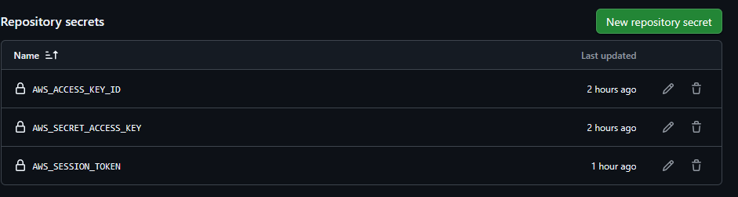

## 5. ECS-Services vorbereiten

In AWS haben wir die ECS-Services vorbereitet, sodass der Deploy-Schritt auf bestehende Ressourcen zugreifen konnte. Der Cluster, der ECS-Service und die Task Definition waren vorhanden. Zudem wurde sichergestellt, dass der Containername in der Task Definition mit dem Workflow übereinstimmt.

- ECS-Cluster für die Full-Stack-Anwendung erstellt.
- Separate ECS Services für Frontend und Backend eingerichtet.
  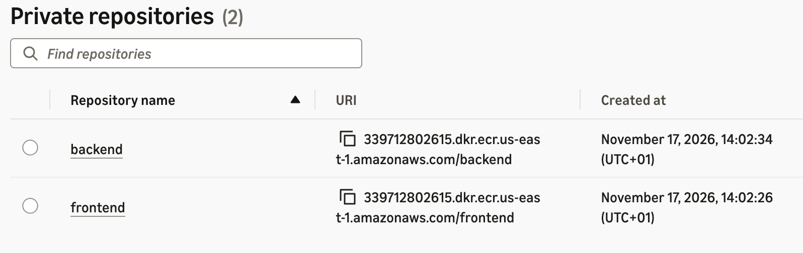
- Services mit den jeweiligen Task Definitions verbunden.

## 6. Task Definition erstellen und anpassen

Für Frontend und Backend wurden die ECS-Task-Definitions angelegt beziehungsweise an die AWS-Umgebung angepasst. Die Familienbezeichnung `family` wurde auf die gegewählte AWS-Task-Definition gesetzt. Der Name in `containerDefinitions[].name` wurde auf `Main` festgelegt, damit der Workflow den richtigen Container findet. Das Feld `image` verweist auf das passende ECR-Image und `executionRoleArn` enthält die ECS-Execution-Role. Dadurch konnte der Workflow die bestehende Task Definition aktualisieren und eine neue Revision bereitstellen.

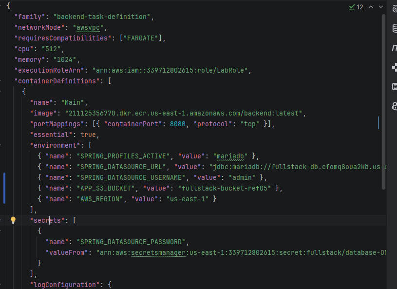

Zusätzlich wurden in Amazon ECR zwei Repositories erstellt:

- `frontend` für das Frontend-Image.
- `backend` für das Backend-Image.

ECS verwendet diese Images, um die Container zu starten.

## 7. IAM-Rolle für ECS

Als ECS-Execution-Role wurde eine Rolle mit Elastic Container Service als vertrauenswürdigem Dienst und Elastic Container Task als Use Case eingerichtet. Ihr wurde die Richtlinie `AmazonECSTaskExecutionRolePolicy` zugewiesen. Die Rolle wurde anschliessend in der Task Definition hinterlegt. Für die Rolle wurde die LabRole verwendet.

Die Rolle ermöglicht insbesondere:

- Abrufen der Container-Images aus ECR.
- Schreiben der Container-Logs in CloudWatch.
- Abrufen der Zugangsdaten aus Secrets Manager.
  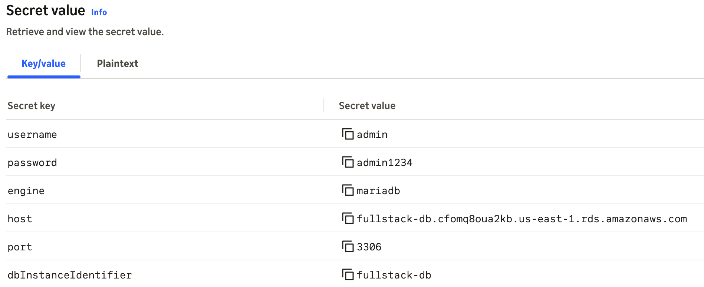

Im Code:

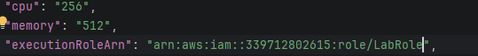

Auf AWS:

## 8. RDS einrichten
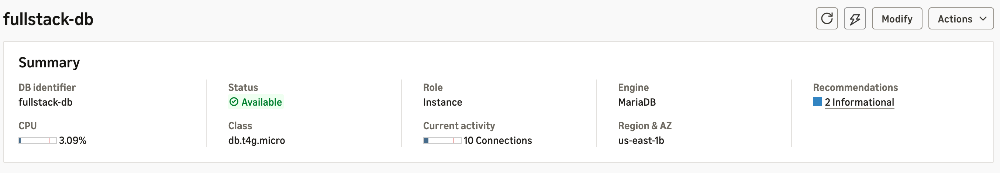
Auf Amazon RDS haben wir eine MariaDB-Instanz erstellt und den Datenbanknamen, einen Benutzer und ein Passwort festgelegt. Das Passwort wurde in AWS Secrets Manager gespeichert. Das Backend wurde über Umgebungsvariablen für die Verbindung zur Datenbank konfiguriert.

Zusätzlich haben wir folgende Konfiguration vorgenommen:

- MariaDB als Datenbank-Engine verwendet.
- Backend mit der RDS-Datenbank verbunden.
- Datenbank-Zugangsdaten in AWS Secrets Manager gespeichert.
- Secret in der Backend Task Definition referenziert.
- Separate RDS Security Group für die Absicherung des Datenbankzugriffs eingerichtet.

## 9. S3 für Bilder einrichten
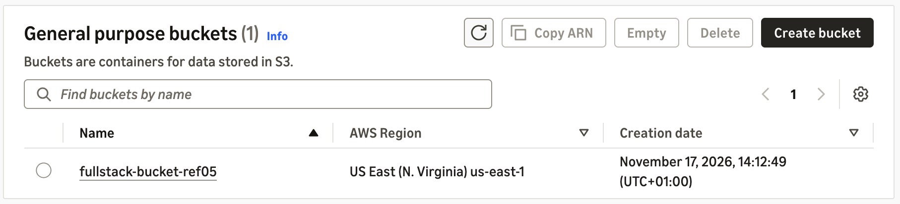
Für die Ablage von Bildern haben wir einen eigenen S3-Bucket erstellt und eine IAM-Rolle für das Backend eingerichtet. Die Berechtigungen der Rolle wurden auf den benötigten Bucket und die erforderlichen Aktionen eingeschränkt. Dadurch verwendet das Backend den S3-Bucket anstelle eines lokalen Speicherpfads für Bilder.

- S3-Bucket für die Speicherung der Bilder erstellt.
- Backend für die Verwendung des Buckets konfiguriert.
- IAM-Berechtigungen für den Zugriff auf den Bucket eingerichtet.

## 10. Frontend und Backend verbinden

Die API-Adresse des Backends wurde im Frontend über `VITE_API_BASE_URL` gesetzt. Der Build konnte dadurch die richtige Backend-Adresse verwenden und API-Aufrufe an den ECS-Service senden.
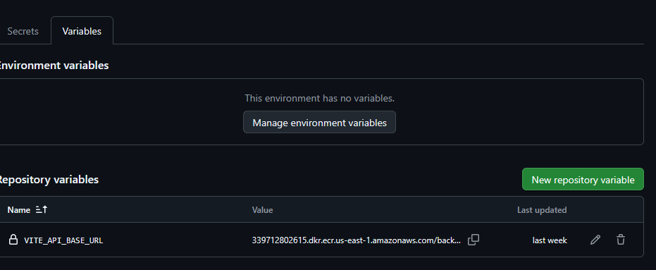

Zusätzlich wurde ein Application Load Balancer (ALB) eingerichtet.

**Load Balancer und Weiterleitung:**
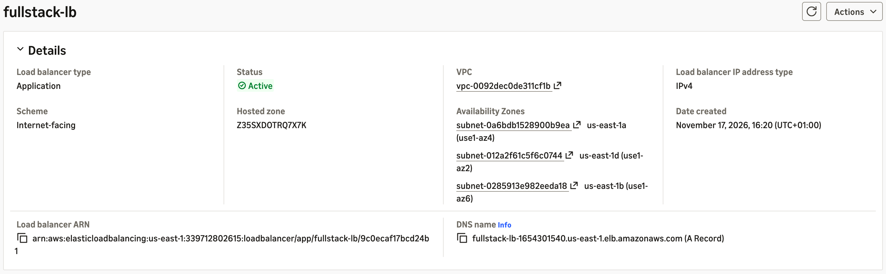

- HTTP-Listener für eingehende Anfragen eingerichtet.
  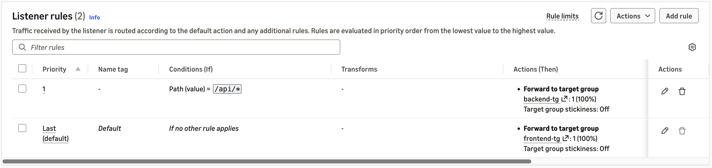
- Separate Target Groups für Frontend und Backend erstellt.
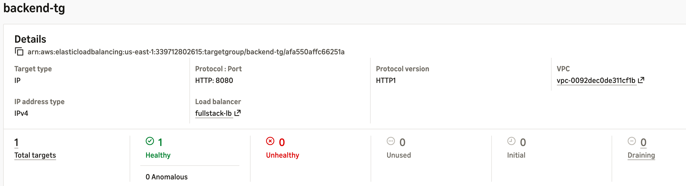
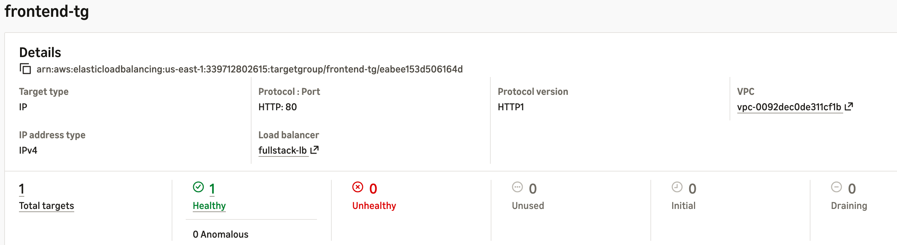
- API-Anfragen an das Backend weitergeleitet.
- Alle übrigen Anfragen an das Frontend weitergeleitet.
- Health Checks für beide Target Groups konfiguriert.

**Security Groups:**

Für die Netzwerkkommunikation wurden drei Security Groups eingerichtet:

- **Load Balancer Security Group:** Regelt den Zugriff von aussen über HTTP und HTTPS.
  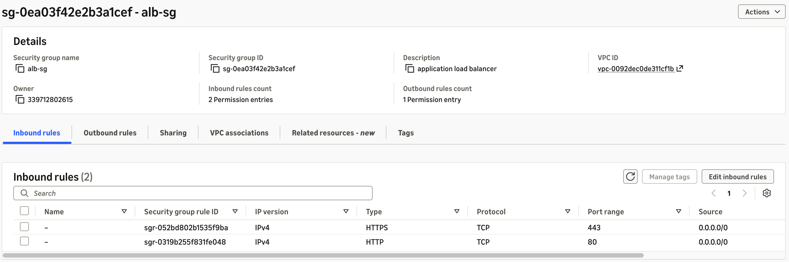
- **ECS Security Group:** Erlaubt die Kommunikation vom Load Balancer zu den Frontend- und Backend-Containern.
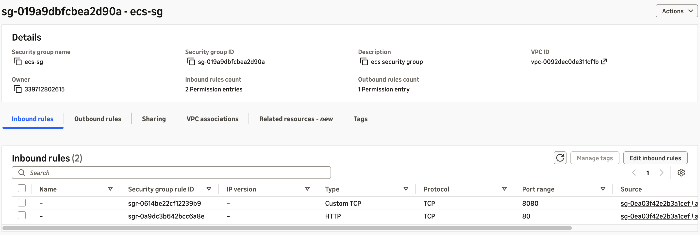
- **RDS Security Group:** Beschränkt den Netzwerkzugriff auf die MariaDB-Datenbank.
  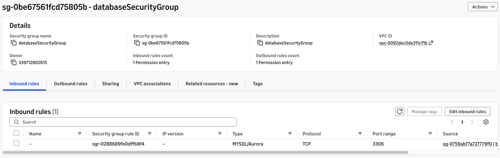

## 11. Push auf GitHub und Deployment

Nach Abschluss der Konfiguration haben wir für beide Repositories einen Commit auf den Branch `main` gepusht. GitHub Actions führte daraufhin automatisch die Tests und den Build aus, erstellte das Docker-Image, stellte es in das entsprechende ECR-Repository und deployte es auf ECS. Wir haben es anschliessend noch ein paar mal laufen gelassen. Manchmal wurde die Pipeline zwar Rot aber das Image landete trotzdem im ECR-Repository und das Deployment auf ECS war erfolgreich. Die Anwendung war danach über die öffentliche URL des ECS-Services erreichbar. 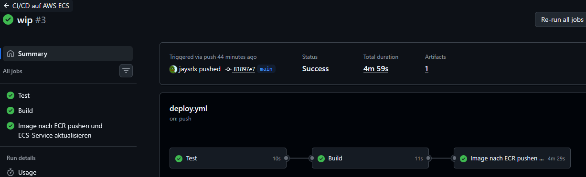

Für die Überwachung der Anwendung wurde Amazon CloudWatch verwendet:

- Zentrale Log Group für die ECS-Container eingerichtet.
- Anwendungs- und Systemmeldungen der Container werden gespeichert.
- Logs können über die AWS Management Console eingesehen werden.

## 12. Abschluss

Damit wurde die Aufgabe erfolgreich umgesetzt. Frontend und Backend befinden sich in getrennten GitHub-Repositories und verfügen über eigene Pipelines, ECR-Repositories und ECS-Services. Die Datenbank läuft auf MariaDB in Amazon RDS, Bilder werden in S3 gespeichert und das Deployment erfolgt über GitHub Actions auf AWS ECS.

Zusätzlich wurden folgende AWS-Komponenten eingerichtet:

- Application Load Balancer für die Weiterleitung der Anfragen.
- Drei Security Groups zur Regelung der Netzwerkzugriffe.
- Secrets Manager für die Datenbank-Zugangsdaten.
- IAM-Rolle für die Berechtigungen der ECS-Tasks.
- CloudWatch für die Container-Logs.